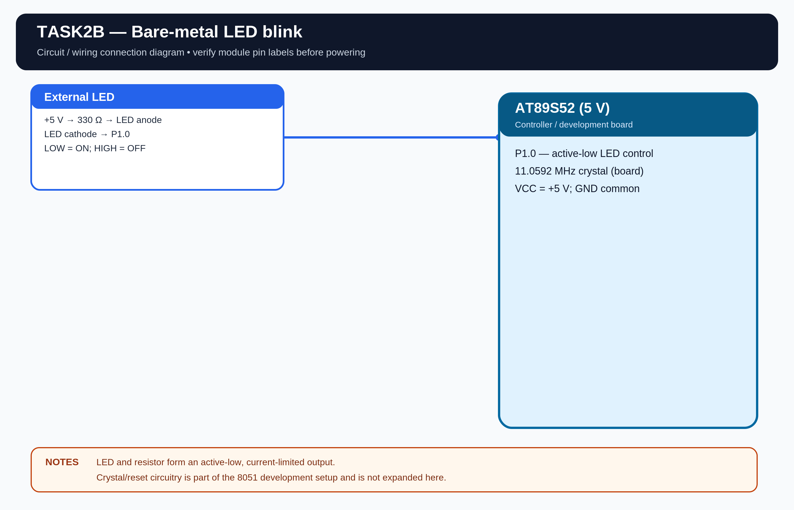

# EXPERIMENT DETAILS

**EXP:** CONTINUOUS ASSESSMENT 2

**DATE:** 20/07/2026

**NAME OF EXP:** 8051 Development Board Tool Chain Setup

**HARDWARE SETUP / PLATFORM:** AT89S52 Microcontroller + Keil µVision

---

## TASK 2B : Bare-Metal LED Blink

### 1. Hardware Setup

The experiment uses an AT89S52 microcontroller to control an external LED through GPIO pin P1.0.

- **Microcontroller:** AT89S52
- **CPU Core:** 8-bit 8051
- **GPIO Port:** Port 1
- **GPIO Pin:** P1.0
- **Peripheral:** External LED with 330 Ω current-limiting resistor
- **Power Supply:** 5V DC
- **LED Active State:** LOW
- **Crystal Frequency:** 11.0592 MHz
- **Debug Interface:** SPI-based ISP programmer
- **Blink Frequency:** Approximately 1 Hz

**Assumptions:** I have used 5V as the nominal supply, 11.0592 MHz as the crystal frequency, and an SPI-based ISP programmer for the hardware setup details. The LED is assumed to be connected in active-low configuration through a 330 Ω resistor. These are assumed setup values, not exact recorded meter readings.

### 2. Circuit Diagram

### 3. Core Logic / Pseudocode / Code Base

**Working Principle:**

The external LED is connected to pin P1.0 of the AT89S52. The program switches the GPIO pin between LOW and HIGH states with a software delay between transitions.

Since the LED is connected in active-low configuration, setting P1.0 LOW turns the LED ON and setting it HIGH turns it OFF.

**Pseudocode:**

1. Include the 8051 register definition and delay header files.
2. Define P1.0 as the LED control pin.
3. Create a custom delay function using nested loops.
4. Turn the LED ON by setting P1.0 LOW.
5. Call the delay function.
6. Turn the LED OFF by setting P1.0 HIGH.
7. Call the delay function again.
8. Repeat continuously.

**Code Base:**

The program is written in Embedded C using Keil C51.

- `reg51.h` provides the 8051 register definitions.
- `sbit LED = P1^0` assigns the LED to pin P1.0.
- `LED = 0` turns the active-low LED ON.
- `LED = 1` turns the LED OFF.
- `delay_ms()` uses nested loops to generate a software delay.
- `main.c` contains the LED control logic.
- `delay.c` and `delay.h` contain the custom delay function.

### 4. Inference

The LED connected to P1.0 blinks continuously as the microcontroller alternates the GPIO output between LOW and HIGH states.

The experiment demonstrates 8051 toolchain setup, GPIO output control, direct register access and custom software delay generation.
