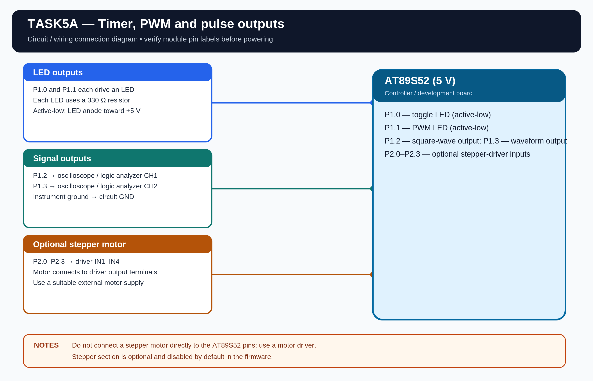

# EXPERIMENT DETAILS

**EXP:** CONTINUOUS ASSESSMENT 5

**DATE:** 10/08/2026

**NAME OF EXP:** Hardware Timer and Interrupt-Based Timing for LED Fading, Pulse Generation, and Stepper Motor Control

**HARDWARE SETUP / PLATFORM:** AT89S52 Microcontroller + Keil µVision

---

## TASK 5A : Timer-Based LED and Pulse Controller

### 1. Hardware Setup

The experiment uses hardware timer interrupts to control LED timing, generate PWM and produce different pulse signals.

- **Microcontroller:** AT89S52
- **CPU Core:** 8-bit 8051
- **LED Toggle Pin:** P1.0
- **PWM LED Pin:** P1.1
- **Square-Wave Output:** P1.2
- **Waveform Output:** P1.3
- **Optional Stepper Outputs:** P2.0-P2.3 through a motor driver
- **Power Supply:** 5V DC
- **Crystal Frequency:** 11.0592 MHz
- **Timer 0:** 1 ms interrupt
- **Timer 1:** Approximately 100 µs interrupt
- **PWM Frequency:** 500 Hz
- **Hardware Debug:** Multimeter and oscilloscope

**Assumptions:** I have used P1.0 and P1.1 for the two LED outputs, P1.2 and P1.3 for signal outputs, and an 11.0592 MHz crystal. The LEDs are assumed to be active-low with 330 Ω current-limiting resistors. The timer intervals are based on a classic 12-clock 8051 core.

### 2. Circuit Diagram

### 3. Core Logic / Pseudocode / Code Base

**Working Principle:**

Timer 0 generates a 1 ms system time base. Timer 1 generates an approximately 100 µs interrupt used for software PWM and signal generation. The main loop checks elapsed time and updates the outputs without using software delay loops.

**Task 1 — LED Toggle:**

The LED connected to P1.0 changes state once every second using the Timer 0 time base.

**Task 2 — LED Fading:**

The LED connected to P1.1 is controlled using 500 Hz software PWM. Its duty cycle gradually increases from 0% to 100% and then decreases back to 0%.

**Task 3 — Pulse Generation:**

The square-wave output on P1.2 cycles through the following frequencies:

- Mode 1: 100 Hz
- Mode 2: 500 Hz
- Mode 3: 1 kHz
- Mode 4: 2 kHz
- Mode 5: 5 kHz

The waveform output on P1.3 cycles through square wave, variable duty-cycle wave, pulse train and burst signal. The frequency and waveform modes change automatically at 2-second intervals.

**Task 4 — Stepper Motor (Optional):**

An optional four-step sequence is included in the source code and is disabled by default. It uses P2.0-P2.3 in the sequence 1000, 0100, 0010, 0001 and must be connected through a suitable motor driver, not directly to the microcontroller. Set `STEPPER_ENABLE` to 1 to enable it. `STEPPER_DIRECTION` selects direction, while `STEPPER_SPEED_MODE` selects 100 ms/step, 50 ms/step or 10 ms/step.

**Pseudocode:**

1. Configure Timer 0 and Timer 1.
2. Generate periodic timer interrupts.
3. Use Timer 0 as the system time base.
4. Toggle the LED every second.
5. Generate 500 Hz PWM and vary its duty cycle from 0% to 100% and back.
6. Generate the required square-wave frequencies and signal types.
7. Repeat continuously without software delay loops.

**Code Base:**

The program is written in Embedded C using Keil C51.

- `timer0_isr()` generates the 1 ms system time base.
- `timer1_isr()` updates PWM and signal outputs.
- `update_led_fade()` changes the PWM duty cycle.
- `update_square_wave()` generates the selectable square-wave frequency.
- `update_waveform()` generates the different signal types.
- `update_stepper()` contains the optional stepper motor sequence.

### 4. Inference

The timers generate periodic interrupts that are used to control LED timing, LED brightness and pulse signals. The program performs the timing operations without using software delay loops.

The experiment demonstrates hardware timer configuration, interrupt handling, software PWM, variable-frequency signal generation and optional stepper motor sequencing.
