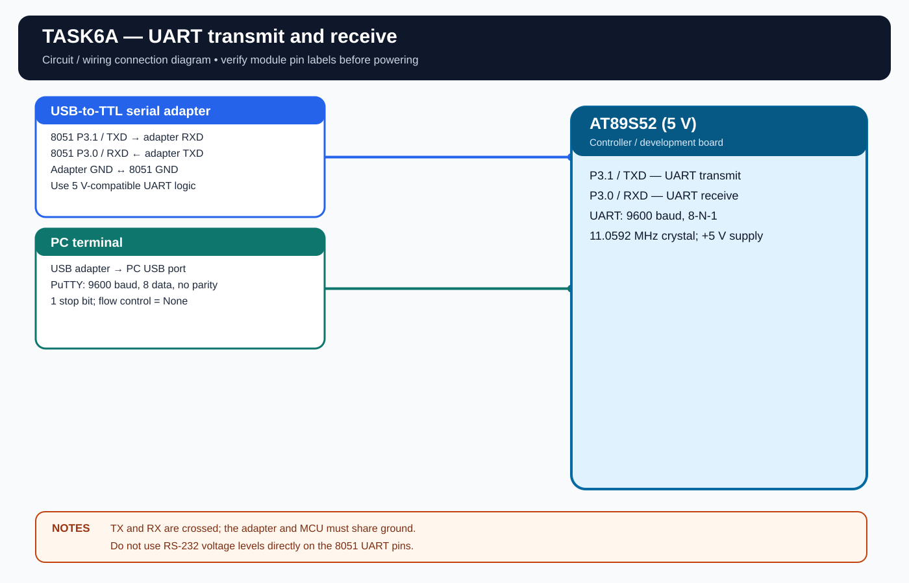

# EXPERIMENT DETAILS

**EXP:** CONTINUOUS ASSESSMENT 6

**DATE:** 17/08/2026

**NAME OF EXP:** UART Driver and Serial Debugging

**HARDWARE SETUP / PLATFORM:** AT89S52 Microcontroller + Keil µVision

---

## TASK 6A : UART Initialization, Transmission and Echo

### 1. Hardware Setup

The experiment uses UART serial communication between the AT89S52 and a PC terminal through a USB-to-TTL converter.

- **Microcontroller:** AT89S52
- **CPU Core:** 8-bit 8051
- **UART Mode:** Mode 1, 8-bit asynchronous
- **Baud Rate:** 9600
- **Frame Format:** 8-N-1
- **TXD Pin:** P3.1
- **RXD Pin:** P3.0
- **Interface:** USB-to-TTL serial converter
- **Terminal Software:** PuTTY
- **Crystal Frequency:** 11.0592 MHz

I have used an 11.0592 MHz crystal and a USB-to-TTL converter with 5V-compatible UART logic. P3.1 (TXD) is connected to converter RXD, converter TXD is connected to P3.0 (RXD), and both devices share a common ground.

### 2. Circuit Diagram

### 3. Core Logic / Pseudocode / Code Base

**Working Principle:**

The 8051 UART is configured in Mode 1 for 9600-8-N-1 communication. Timer 1 is configured in mode 2 to generate the baud rate.

The program continuously transmits `Hello from 8051` to the PC terminal. Characters typed in PuTTY are received through the UART interrupt, stored in a ring buffer and transmitted back to the terminal.

**Pseudocode:**

1. Configure the UART for 9600-8-N-1 communication.
2. Configure Timer 1 for baud-rate generation.
3. Enable the serial interrupt.
4. Transmit `Hello from 8051` periodically.
5. Receive incoming characters through the UART interrupt.
6. Store received characters in the RX ring buffer.
7. Read characters from the buffer and transmit them back.
8. Repeat continuously.

**PuTTY Settings:** Select the USB-to-TTL COM port, set the speed to 9600, data bits to 8, stop bits to 1, parity to None and flow control to None. Disable local echo so the returned character from the 8051 is visible only once.

**Code Base:**

The program is written in Embedded C using Keil C51.

- `SCON = 0x50` configures UART Mode 1 and enables reception.
- `TH1 = 0xFD` sets the Timer 1 reload value for 9600 baud at 11.0592 MHz.
- `uart_init()` initializes the UART.
- `uart_putc()` transmits a character using the TX ring buffer.
- `uart_puts()` transmits a string.
- `uart_isr()` handles UART transmit and receive interrupts.
- `uart_getc()` reads a character from the RX ring buffer.
- `uart_available()` checks whether received data is available.
- `Objects/TASK6A.hex` contains the compiled firmware.

### 4. Inference

The 8051 transmits `Hello from 8051` to the PC terminal and echoes back the characters typed in PuTTY.

The experiment demonstrates UART configuration, baud-rate generation using Timer 1, serial interrupts, character transmission and reception, and RX ring-buffer implementation.
