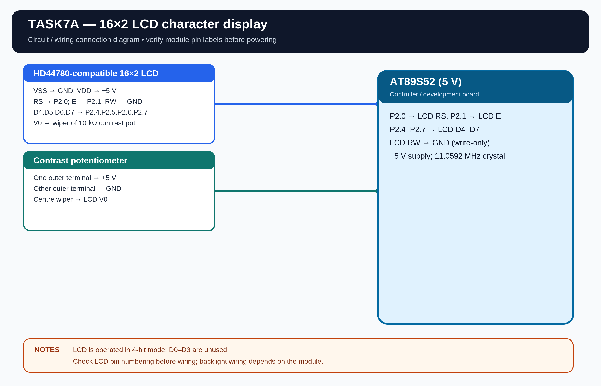

# EXPERIMENT DETAILS

**EXP:** CONTINUOUS ASSESSMENT 7

**DATE:** 24/08/2026

**NAME OF EXP:** 16x2 LCD Driver Development and Dynamic Display Control

**HARDWARE SETUP / PLATFORM:** AT89S52 Microcontroller + Keil µVision

---

## TASK 7A : LCD Initialization and Character/String Display

### 1. Hardware Setup

The experiment uses an HD44780-compatible 16x2 LCD connected to the AT89S52 using a 4-bit GPIO interface.

- **Microcontroller:** AT89S52
- **LCD:** 16x2 HD44780-compatible
- **Interface:** 4-bit mode
- **LCD RS:** P2.0
- **LCD E:** P2.1
- **LCD D4-D7:** P2.4-P2.7
- **LCD RW:** GND
- **Power Supply:** 5V DC
- **Contrast:** 10 kΩ potentiometer at V0
- **Crystal Frequency:** 11.0592 MHz

**Assumptions:** I have used P2.0 and P2.1 for RS and E, P2.4-P2.7 for D4-D7, and connected RW to GND. The LCD is assumed to use a 5V supply with a contrast potentiometer.

### 2. Circuit Diagram

### 3. Core Logic / Pseudocode / Code Base

**Working Principle:**

The LCD is initialized by sending commands to configure 4-bit mode, 2-line display, cursor settings and display control. After initialization, the character 'A' is displayed at the first position of the first row and a string is displayed on the second row.

**Pseudocode:**

1. Configure the LCD GPIO pins.
2. Initialize the LCD in 4-bit, 2-line mode.
3. Set the display ON and cursor OFF.
4. Move the cursor to the first position.
5. Display the character 'A'.
6. Move to the second row and display a string.

**Code Base:**

The program is written in Embedded C using Keil C51.

- `lcd_init()` initializes the LCD.
- `lcd_cmd()` sends commands to the LCD.
- `lcd_data()` sends character data.
- `lcd_goto()` positions the cursor.
- `lcd_puts()` displays a string.

### 4. Inference

The LCD is initialized in 4-bit, 2-line mode and displays the character 'A' on the first row and a string on the second row. The experiment demonstrates LCD initialization, command transfer and character/string display.
