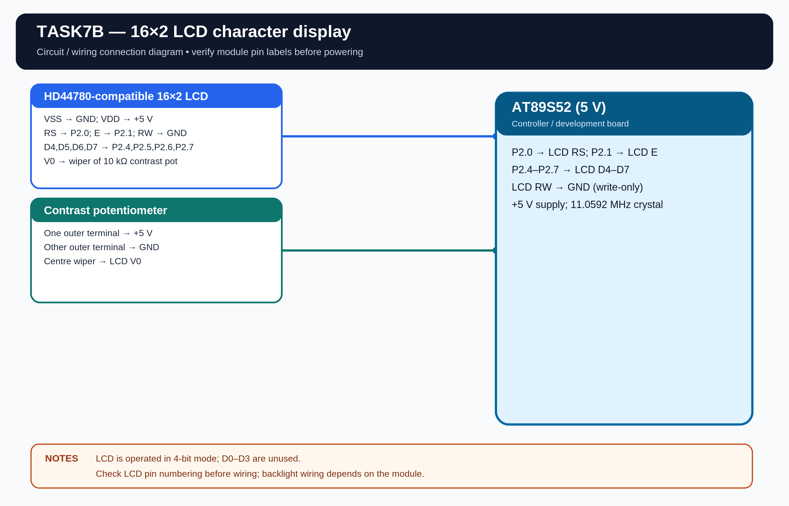

# EXPERIMENT DETAILS

**EXP:** CONTINUOUS ASSESSMENT 7

**DATE:** 24/08/2026

**NAME OF EXP:** 16x2 LCD Driver Development and Dynamic Display Control

**HARDWARE SETUP / PLATFORM:** AT89S52 Microcontroller + Keil µVision

---

## TASK 7B : Cursor Positioning and Dynamic Value Update

### 1. Hardware Setup

The experiment uses an HD44780-compatible 16x2 LCD connected to the AT89S52 using a 4-bit GPIO interface.

- **Microcontroller:** AT89S52
- **LCD:** 16x2 HD44780-compatible
- **Interface:** 4-bit mode
- **LCD RS:** P2.0
- **LCD E:** P2.1
- **LCD D4-D7:** P2.4-P2.7
- **LCD RW:** GND
- **Power Supply:** 5V DC
- **Crystal Frequency:** 11.0592 MHz

**Assumptions:** I have used P2.0 and P2.1 for RS and E, P2.4-P2.7 for D4-D7, and connected RW to GND. The LCD is assumed to use a 5V supply with a contrast potentiometer.

### 2. Circuit Diagram

### 3. Core Logic / Pseudocode / Code Base

**Working Principle:**

The LCD cursor is positioned using row and column values. A changing numeric value is displayed on the second row and updated continuously.

**Pseudocode:**

1. Initialize the LCD in 4-bit, 2-line mode.
2. Display a heading on the first row.
3. Move the cursor to the second row.
4. Display the text "Value:".
5. Convert the numeric value into decimal digits and display it.
6. Increment the value and update the display.
7. Repeat continuously.

**Firmware Output:**

The compiled HEX file is saved at `Objects/TASK7B.hex`.

**Code Base:**

The program is written in Embedded C using Keil C51.

- `lcd_init()` initializes the LCD.
- `lcd_goto(row, column)` positions the cursor.
- `lcd_puts(string)` displays a string.
- `lcd_print_number(value)` displays a decimal number.
- `lcd_cmd()` and `lcd_data()` send commands and character data.

### 4. Inference

The LCD displays a heading and a continuously updated numeric value. The experiment demonstrates cursor positioning, string display and dynamic numeric value updates.
