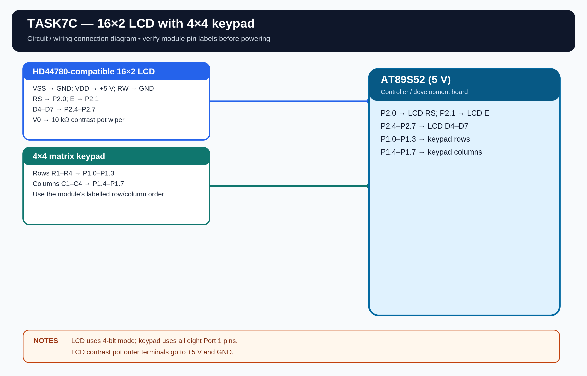

# EXPERIMENT DETAILS

**EXP:** CONTINUOUS ASSESSMENT 7

**DATE:** 24/08/2026

**NAME OF EXP:** 16x2 LCD Driver Development and Dynamic Display Control

**HARDWARE SETUP / PLATFORM:** AT89S52 Microcontroller + Keil µVision

---

## TASK 7C : 4x4 Keypad-Based Character Movement

### 1. Hardware Setup

The experiment uses a 4x4 matrix keypad to move a character across a 16x2 LCD.

- **Microcontroller:** AT89S52
- **LCD:** 16x2 HD44780-compatible, 4-bit mode
- **LCD RS:** P2.0
- **LCD E:** P2.1
- **LCD D4-D7:** P2.4-P2.7
- **LCD RW:** GND
- **Keypad:** 4x4 matrix keypad
- **Keypad Rows:** P1.0-P1.3
- **Keypad Columns:** P1.4-P1.7
- **Power Supply:** 5V DC
- **Crystal Frequency:** 11.0592 MHz

**Assumptions:** I have used P2.0, P2.1 and P2.4-P2.7 for the LCD and P1.0-P1.7 for the 4x4 keypad. The LCD is assumed to be a 5V HD44780-compatible module with RW connected to GND.

### 2. Circuit Diagram

### 3. Core Logic / Pseudocode / Code Base

**Working Principle:**

The character 'A' is displayed on the LCD. The 4x4 keypad is scanned continuously, and keys 2, 8, 4 and 6 are used to move the character up, down, left and right.

**Key Controls:**

- **2:** Move Up
- **8:** Move Down
- **4:** Move Left
- **6:** Move Right

The character is kept within the 16 columns and 2 rows of the LCD. A debounce check is used so that one key press produces one movement.

**Pseudocode:**

1. Initialize the LCD and display the character 'A'.
2. Scan the 4x4 keypad.
3. Check whether key 2, 8, 4 or 6 is pressed.
4. Apply the corresponding row or column movement.
5. Keep the character within the LCD boundaries.
6. Clear the previous character position.
7. Display the character at its new position.
8. Repeat continuously.

**Firmware Output:**

The compiled HEX file is saved at `Objects/TASK7C.hex`.

**Code Base:**

The program is written in Embedded C using Keil C51.

- `keypad_scan()` detects keypad input.
- `move_character()` updates the character position.
- `lcd_goto()` selects the LCD row and column.
- `lcd_data()` displays the character.
- A 20 ms debounce check avoids repeated movement from one key press.

### 4. Inference

The character moves across both rows of the LCD according to the keypad direction keys. The experiment demonstrates LCD cursor control, matrix keypad scanning and basic user-interface development using the AT89S52.
