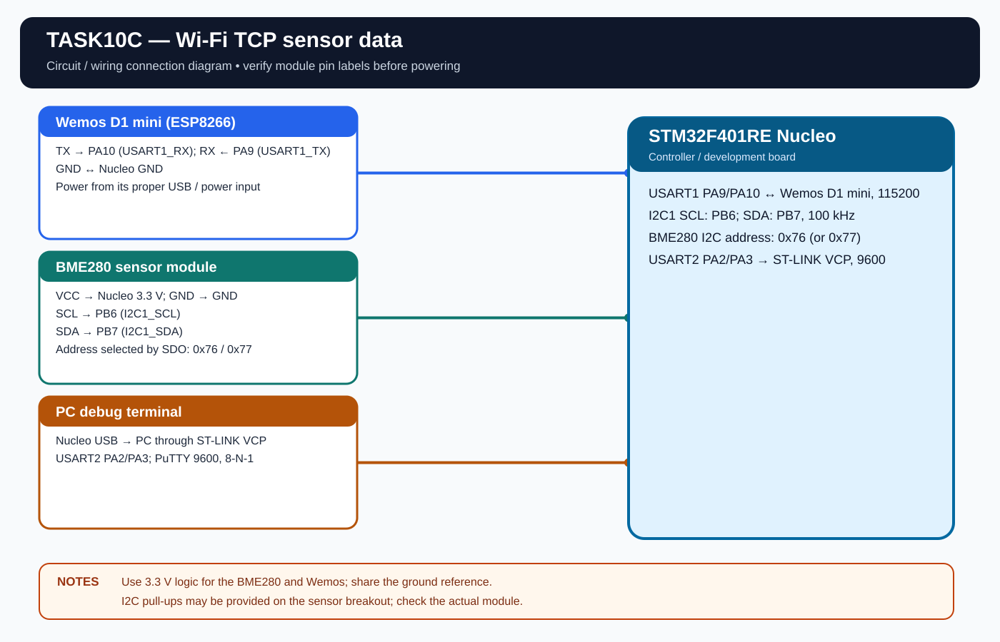

# EXPERIMENT DETAILS

**EXP:** CONTINUOUS LAB EVALUATION 10

**DATE:** 05/10/2026

**NAME OF EXP:** Connect Wemos to Wi-Fi and Send Sensor Data

**HARDWARE:** STM32F401RE Nucleo + Wemos D1 Mini (ESP8266) + BME280

## Aim

Configure the Wemos ESP8266 as a Wi-Fi station using AT commands, connect to a local Wi-Fi network, read sensor data through the STM32 and send the data over a TCP connection.

## Connections

| Purpose | STM32 pins |
|---|---|
| Wemos USART1 TX/RX | PA9 TX, PA10 RX |
| PC terminal USART2 TX/RX | PA2 TX, PA3 RX |
| BME280 I2C1 SCL/SDA | PB6 SCL, PB7 SDA |

**Wemos:** TX to PA10, RX to PA9 and common GND. The Wemos UART is configured for 115200, 8-N-1. PC terminal USART2 uses 9600, 8-N-1.

**BME280:**

| BME280 pin | STM32 pin |
|---|---|
| VCC | 3.3V |
| GND | GND |
| SCL | PB6 |
| SDA | PB7 |

The BME280 driver checks I2C address 0x76 and 0x77.

## Wi-Fi Configuration

Before building, edit \`Core/Inc/app_config.h\` and set:

- \`WIFI_SSID\`
- \`WIFI_PASSWORD\`
- \`TCP_SERVER_IP\`
- \`TCP_SERVER_PORT\`

The ESP8266 uses 2.4 GHz Wi-Fi. The TCP receiver must be reachable on the same local network.

## AT Command Flow

The program checks the modem, reads its firmware version, sets station mode, scans available access points, joins the configured network and queries the network address/status.

Commands used include:

- \`AT\`
- \`AT+GMR\`
- \`AT+CWMODE=1\`
- \`AT+CWLAP\`
- \`AT+CWJAP="SSID","PASSWORD"\`
- \`AT+CIFSR\`
- \`AT+CWSTATE?\`
- \`AT+CIPSTART="TCP","SERVER_IP",PORT\`
- \`AT+CIPSEND=LENGTH\`

## Sensor Data

The BME280 readings include temperature, pressure and relative humidity. A formatted data line is displayed on the PC terminal every 5 seconds. If the TCP connection is available, the same data is sent through the Wemos.

## TCP Receiver

A simple receiver is included at \`Tools/tcp_server.py\`.

1. Run it on the PC with \`python Tools/tcp_server.py\`.
2. Find the PC IPv4 address using \`ipconfig\`.
3. Set that address as \`TCP_SERVER_IP\` in \`app_config.h\`.
4. Keep the Wemos and PC on the same Wi-Fi network.
5. Allow the server port through the PC firewall if prompted.

## Circuit Diagram

## Build

Open \`MDK-ARM/TASK10C.uvprojx\` in Keil MDK-ARM and build the target. The HEX output is created in \`MDK-ARM/Objects/\`.

The existing CAT10 HEX is retained here as the earlier Task 10C build. Rebuild from this standalone project to regenerate its output.

## Testing

The previous CAT10 project build completed successfully. Hardware testing of this standalone Task 10C project is pending.
