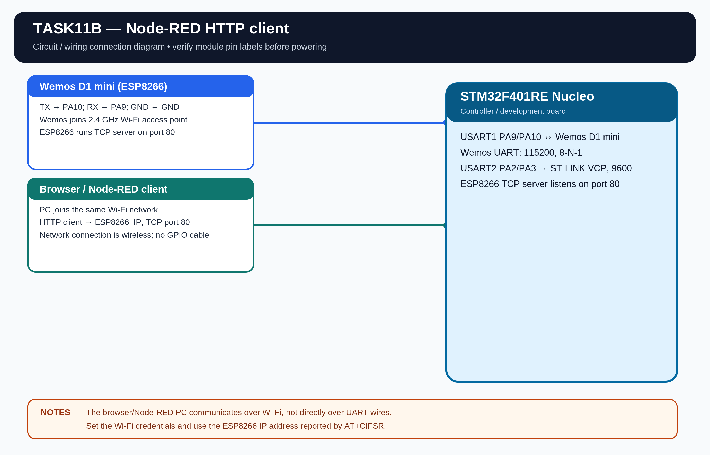

# EXPERIMENT DETAILS

**EXP:** CONTINUOUS LAB EVALUATION 11

**DATE:** 14/10/2026

**NAME OF EXP:** On-board Switch Control with State Remembrance and Short/Long Press Detection

**HARDWARE:** STM32F401RE Nucleo

## Aim

Use the on-board user button to control the LED, remember its state after the button is released and distinguish short presses from long presses.

## Configuration

- Board: NUCLEO-F401RE.
- LED: LD2 on PA5, active high.
- Button: B1 on PC13, active low.
- Button input: internal pull-up.
- Debounce interval: 25 ms.
- Long-press threshold: 1000 ms.
- Clock: internal HSI, 16 MHz.

## Working

A debounced short press toggles the remembered LED state. Releasing the button does not reset that state. A long press (1000 ms or more) switches the LED into or out of continuous blinking mode.

The assignment requires different actions for short and long presses but does not prescribe the exact actions. The short-toggle/long-blink behavior is the implementation used here.

## Algorithm

1. Initialize HAL, GPIOA and GPIOC.
2. Read the button and debounce changes for 25 ms.
3. Record the tick when a stable press begins.
4. On release, calculate the press duration.
5. For a short press, toggle the remembered LED state.
6. For a long press, toggle blinking mode.
7. While blinking mode is active, toggle LD2 at the configured interval.

## Code

The program uses HAL_GPIO_ReadPin(), HAL_GPIO_WritePin(), HAL_GPIO_TogglePin() and HAL_GetTick().

## Circuit Diagram

## Build

Open MDK-ARM/TASK11B.uvprojx in Keil MDK-ARM and build the target. The HEX output is created in MDK-ARM/Objects/.

## Testing

The standalone Task11B project is prepared. Hardware testing is pending.
