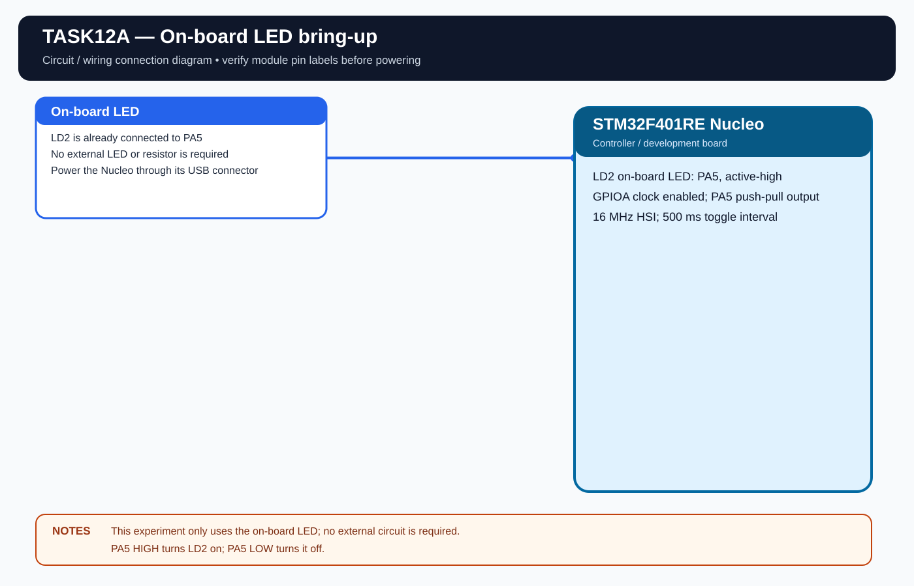

# EXPERIMENT DETAILS

**EXP:** CONTINUOUS LAB EVALUATION 12

**DATE:** 14/10/2026

**NAME OF EXP:** On-board LED Bring-Up

**HARDWARE:** STM32F401RE Nucleo

## Aim

Develop and run a program to verify the NUCLEO-F401RE GPIO output configuration by blinking the on-board LED at a fixed interval.

## Configuration

- Board: NUCLEO-F401RE.
- LED: LD2 on PA5, active high.
- Clock: internal HSI, 16 MHz.
- Blink interval: 500 ms.

## Working

The program configures PA5 as a GPIO output and toggles LD2 every 500 ms.

## Algorithm

1. Initialize HAL and the system clock.
2. Enable GPIOA clock.
3. Configure PA5 as push-pull output.
4. Toggle PA5.
5. Wait 500 ms and repeat.

## Circuit Diagram

## Build

Open MDK-ARM/TASK12A.uvprojx in Keil MDK-ARM and build the target.

## Testing

The standalone Task12A project is prepared. Hardware testing is pending.
