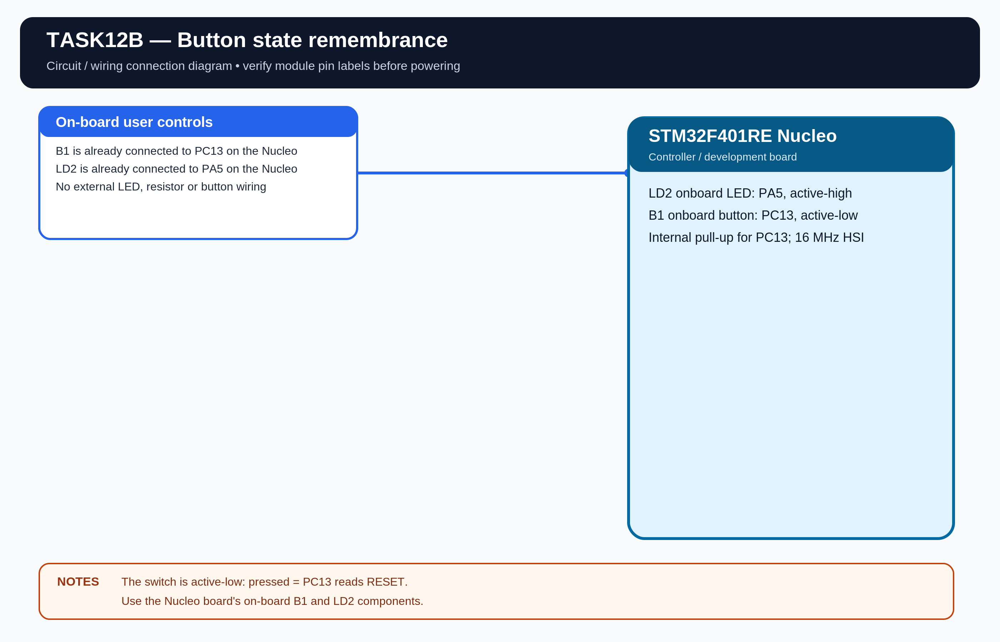

# EXPERIMENT DETAILS

**EXP:** CONTINUOUS LAB EVALUATION 12

**DATE:** 23/10/2026

**NAME OF EXP:** BME280 Data over ESP8266 HTTP

**HARDWARE:** STM32F401RE Nucleo + Wemos D1 Mini (ESP8266) + BME280

## Aim

Read compensated BME280 values and return them as a JSON payload inside a valid HTTP response sent through the ESP8266.

## Connections

| Purpose | STM32 connection |
|---|---|
| ESP8266 UART | USART1: PA9 TX, PA10 RX |
| PC debug terminal | USART2: PA2 TX, PA3 RX |
| BME280 I2C | I2C1: PB6 SCL, PB7 SDA |

Connect TX to RX, RX to TX and use a common ground. UART logic is 3.3V. Wemos UART is configured for 115200 baud, 8-N-1. USART2 terminal is 9600 baud, 8-N-1.

## Working

The STM32 initializes the Bosch BME280 API, connects the ESP8266 to the configured Wi-Fi network and starts a TCP server on port 80. When a browser sends an HTTP request, the STM32 reads the sensor and constructs a JSON payload.

The HTTP response includes:

- HTTP/1.1 200 OK
- Content-Type: application/json
- Content-Length calculated from the actual JSON string length.
- JSON with status, temperature, humidity and pressure.

## Wi-Fi Configuration

Replace WIFI_SSID and WIFI_PASSWORD in Core/Inc/app_config.h. The PC/browser and Wemos must be on the same local network. The ESP8266 IP is displayed by the AT firmware after Wi-Fi connection.

Open http://<ESP8266-IP>/ in a browser to view the JSON response.

## Example JSON

{"status":"success","temperature":28.45,"humidity":62.30,"pressure":1008.72}

The values above are only an example format, not measured readings.

## Circuit Diagram

## Build

Open MDK-ARM/TASK12B.uvprojx in Keil MDK-ARM and build the target.

## Testing

Wi-Fi connection, browser response and sensor output are pending hardware verification.
