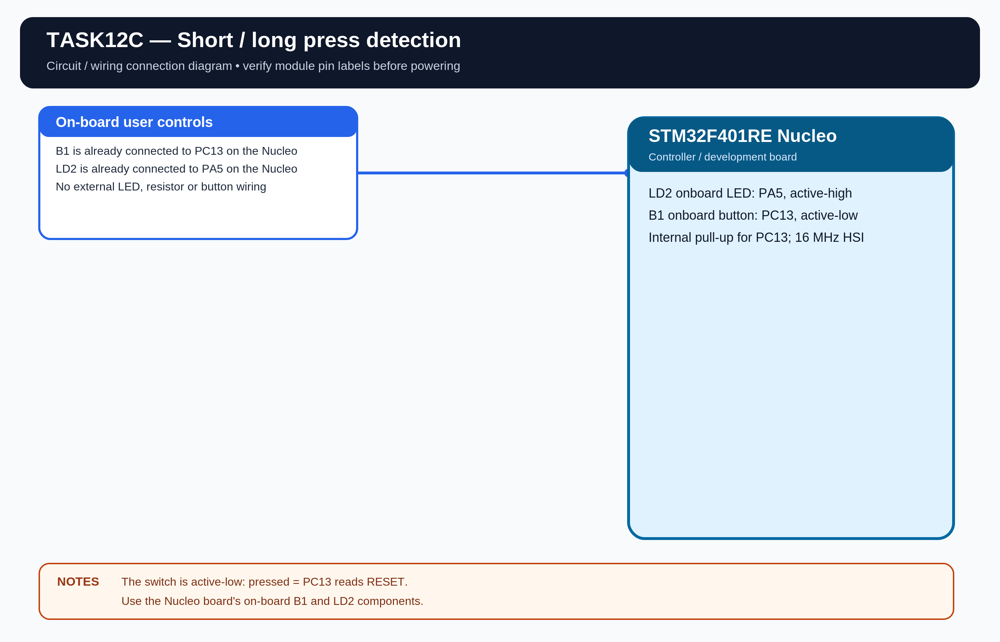

# EXPERIMENT DETAILS

**EXP:** CONTINUOUS LAB EVALUATION 12

**DATE:** 23/10/2026

**NAME OF EXP:** BME280 Node-RED Analytics

**HARDWARE:** STM32F401RE Nucleo + Wemos D1 Mini (ESP8266) + BME280 + Node-RED

## Aim

Send compensated BME280 measurements as JSON over HTTP to Node-RED and calculate the minimum, maximum and average for temperature, humidity and pressure.

## Connections

| Purpose | STM32 connection |
|---|---|
| ESP8266 UART | USART1: PA9 TX, PA10 RX |
| PC debug terminal | USART2: PA2 TX, PA3 RX |
| BME280 I2C | I2C1: PB6 SCL, PB7 SDA |

The Wemos UART is 115200 baud, 8-N-1. The PC terminal is 9600 baud, 8-N-1. BME280 I2C1 is 100 kHz.

## Configuration

Set WIFI_SSID, WIFI_PASSWORD and NODE_RED_IP in Core/Inc/app_config.h. The default Node-RED HTTP endpoint is port 1880 and path /bme280.

The PC and Wemos must be connected to the same local network. Import Tools/NodeRED_flow.json into Node-RED and deploy it before starting the STM32.

## Working

The STM32 reads BME280 temperature, pressure and humidity, creates a JSON object and sends an HTTP POST request to Node-RED. The supplied flow maintains a rolling sample window and calculates minimum, maximum and average values for each parameter.

## Circuit Diagram

## Build

Open MDK-ARM/TASK12C.uvprojx in Keil MDK-ARM and build the target.

## Testing

The Node-RED flow and firmware are prepared. Live data collection and statistics are pending hardware verification.
