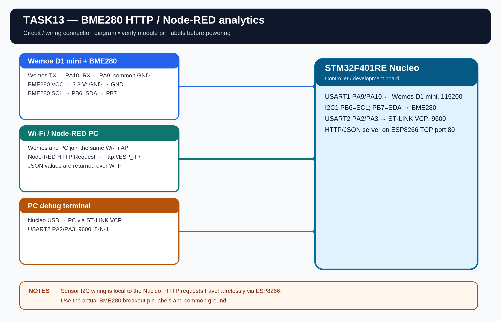

# EXPERIMENT DETAILS

**EXP:** CONTINUOUS LAB EVALUATION 13

**DATE:** 23/10/2026

**NAME OF EXP:** BME280 Sensor Interfacing Using I2C and Bosch SensorAPI - HTTP and Node-RED Analytics

**HARDWARE:** STM32F401RE Nucleo + BME280 + Wemos D1 Mini (ESP8266) + Node-RED

## Aim

Develop an STM32-based environmental sensing application using the BME280 sensor over I2C and the Bosch SensorAPI. The STM32 reads compensated temperature, pressure and humidity, serves the values as JSON through the ESP8266 HTTP server and allows Node-RED to request the data for analytics.

## Driver Files

The project includes the Bosch SensorAPI files:

- Core/Src/bme280.c
- Core/Inc/bme280.h
- Core/Inc/bme280_defs.h

The application provides STM32-specific I2C read, I2C write and delay callback functions. The Bosch driver performs the compensation calculations.

## Connections

| Device | STM32 Nucleo-F401RE |
|---|---|
| BME280 SCL | PB6 (I2C1_SCL) |
| BME280 SDA | PB7 (I2C1_SDA) |
| Wemos TX | PA10 (USART1_RX) |
| Wemos RX | PA9 (USART1_TX) |
| PC debug terminal | PA2/PA3 (USART2) |
| Common ground | GND |

I2C1 is configured at 100 kHz. The primary BME280 address is 0x76; use the secondary address 0x77 if the SDO pin is high. Wemos UART is 115200 baud, 8-N-1. USART2 debug is 9600 baud, 8-N-1.

## Sensor Configuration

- Temperature oversampling: 1x.
- Pressure oversampling: 1x.
- Humidity oversampling: 1x.
- Filter: disabled.
- Sensor mode: normal.
- Standby time: 1000 ms.

## HTTP Server

The STM32 configures the ESP8266 as a TCP server using AT commands. It enables multiple connections, starts the server on port 80, receives browser/Node-RED requests through +IPD and constructs a dynamic JSON response.

The response contains the compensated BME280 values and uses:

- HTTP/1.1 200 OK
- Content-Type: application/json
- Content-Length calculated from the actual JSON payload
- The JSON body with status, temperature, humidity and pressure

The response is sent using AT+CIPSEND in two stages: send the connection ID and length, wait for the prompt, then send the complete HTTP response.

## Wi-Fi Configuration

Set WIFI_SSID and WIFI_PASSWORD in Core/Inc/app_config.h. The Wemos and Node-RED PC must be connected to the same local network. The ESP8266 IP is printed through USART2 after AT+CIFSR.

## Node-RED

Import Tools/NodeRED_flow.json into Node-RED. Change the HTTP Request node URL to http://<ESP8266_IP>/. The flow periodically requests the JSON data, calculates rolling minimum, maximum and average values for temperature, humidity and pressure, and displays the results in the Debug sidebar.

## Circuit Diagram

## Build

Open MDK-ARM/TASK13.uvprojx in Keil MDK-ARM and build the target.

## Testing

The Bosch driver integration, HTTP firmware and Node-RED flow are prepared. I2C communication, browser/Node-RED requests and live sensor statistics are pending hardware verification.
