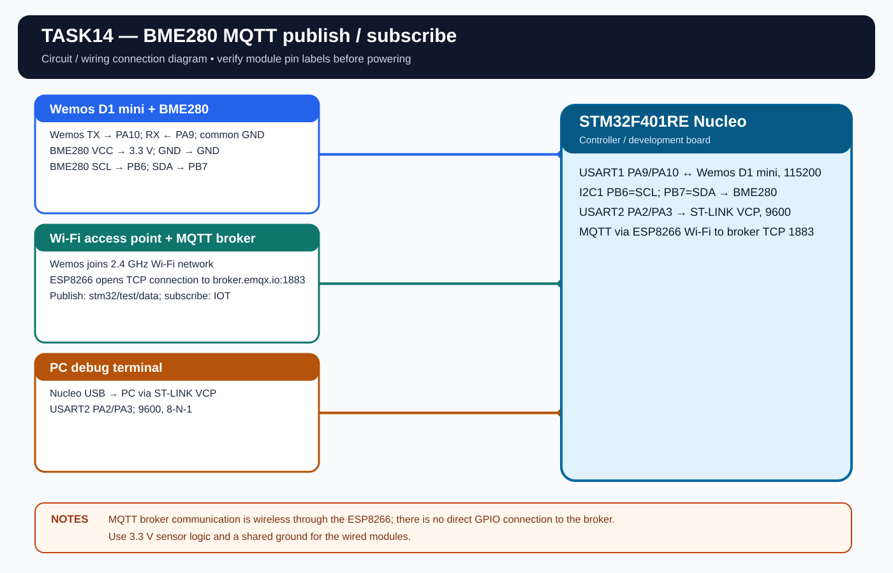

# EXPERIMENT DETAILS

**EXP:** CONTINUOUS LAB EVALUATION 14

**DATE:** 27/10/2026

**NAME OF EXP:** BME280 Sensor Interfacing Using I2C and MQTT with Custom ESP8266 API

**HARDWARE:** STM32F401RE Nucleo + Wemos D1 Mini (ESP8266) + BME280

## Aim

Read compensated BME280 values using I2C and the Bosch SensorAPI, then publish the sensor values over MQTT using the custom ESP8266 library. The application also subscribes to the IOT topic and handles received messages.

## Driver Files

The project includes:

- Bosch BME280 SensorAPI: bme280.c, bme280.h, bme280_defs.h.
- Custom ESP8266/MQTT API: ESPLib.c, ESPLib.h.

The custom API provides ESP8266_Init(), ESP8266_wifiConnect(), ESP8266_portConnect(), MQTT_connectBroker(), MQTT_publishTopic(), MQTT_subscribeTopic(), MQTTDataHandler() and MQTTTimer().

## Connections

| Purpose | STM32 connection |
|---|---|
| ESP8266 UART | USART1: PA9 TX, PA10 RX |
| PC debug terminal | USART2: PA2 TX, PA3 RX |
| BME280 I2C | I2C1: PB6 SCL, PB7 SDA |

Connect TX to RX, RX to TX and use a common ground. Wemos UART is 115200 baud, 8-N-1. USART2 debug is 9600 baud, 8-N-1.

## MQTT Configuration

- Broker: broker.emqx.io
- Port: 1883 (unencrypted TCP).
- Client ID: MqttID.
- Keep alive: 500 seconds.
- Publish topic: stm32/test/data.
- Subscribe topic: IOT.
- Publish QoS: 0.

Set WIFI_SSID and WIFI_PASSWORD in Core/Inc/app_config.h. The ESP8266 must have compatible AT firmware installed and the access point must support 2.4 GHz Wi-Fi.

## Payload

The application publishes a JSON payload containing status, temperature, humidity and pressure. The publish interval is one second.

## Circuit Diagram

## Build

Open MDK-ARM/TASK14.uvprojx in Keil MDK-ARM and build the target.

## Testing

The MQTT library and firmware are prepared. Wi-Fi connection, broker connection, publish and subscribe behavior are pending hardware verification.
