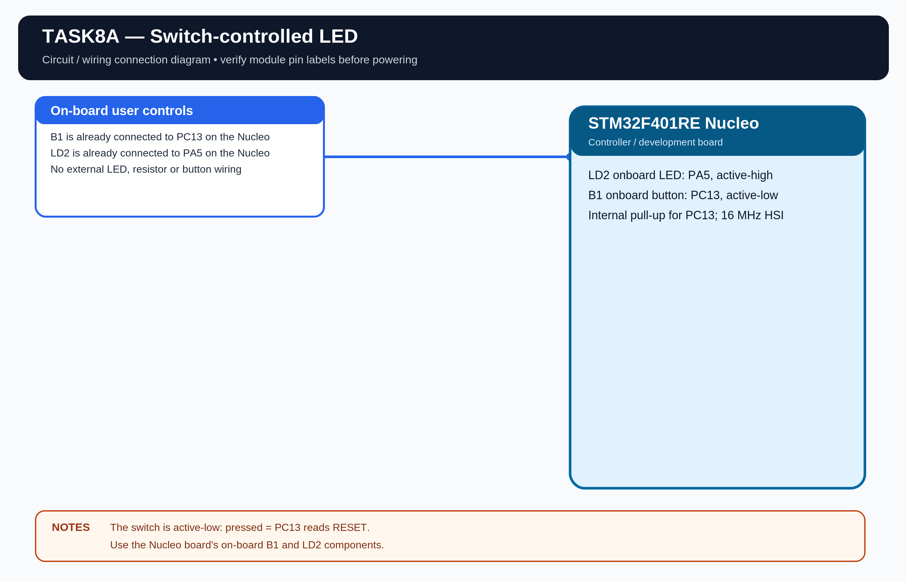

# EXPERIMENT DETAILS

**EXP:** CONTINUOUS LAB EVALUATION 8

**DATE:** 18/09/2026

**NAME OF EXP:** GPIO Input/Output - Switch Controlled LED

**HARDWARE:** STM32F401RE Nucleo

## Aim

Configure the STM32 GPIO pins so the onboard LED follows the state of the user push-button.

## Pin Configuration

- LD2 LED: PA5, output, active high.
- B1 user button: PC13, input, active low, internal pull-up.
- Clock: internal 16 MHz HSI.

## Working

When the button is pressed, the LED turns ON. When the button is released, the LED turns OFF.

## Algorithm

1. Initialize HAL and configure the GPIO pins.
2. Read the button state continuously.
3. If the button is pressed, set PA5.
4. Otherwise, reset PA5.
5. Repeat.

## Code

The program uses \`HAL_GPIO_ReadPin()\` and \`HAL_GPIO_WritePin()\`.

## Circuit Diagram

## Build

Open \`MDK-ARM/TASK8A.uvprojx\` in Keil MDK-ARM and build the target. The HEX output is created in \`MDK-ARM/Objects/\`.

## Testing

The project files are separated for Task 8A. Physical testing of this standalone task build is pending.
