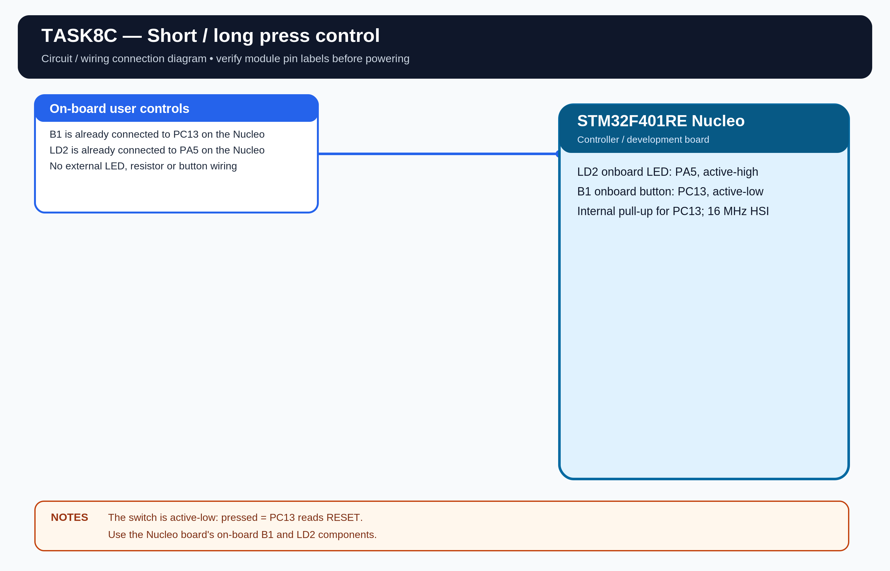

# EXPERIMENT DETAILS

**EXP:** CONTINUOUS LAB EVALUATION 8

**DATE:** 18/09/2026

**NAME OF EXP:** Short Press vs Long Press

**HARDWARE:** STM32F401RE Nucleo

## Aim

Classify a button press by its duration and control the onboard LED according to the required short-press and long-press behavior.

## Pin Configuration

- LD2 LED: PA5, output, active high.
- B1 user button: PC13, input, active low, internal pull-up.
- Short press: less than 1 second.
- Long press: 1 second or more.
- Clock: internal 16 MHz HSI.

## Working

A short press toggles the LED when it is in static mode. A long press enters continuous blinking mode. A short press while blinking stops the blinking. A later long press starts the blinking mode again.

The code records the press start time and release time using \`HAL_GetTick()\`. It does not use a blocking delay to detect a long press.

## Algorithm

1. Initialize HAL and configure the LED and button.
2. Detect and debounce button state changes.
3. Record the tick when the button is pressed.
4. On release, calculate the press duration.
5. For a short press, toggle the LED or stop blinking.
6. For a long press, enter blinking mode.
7. Toggle the LED at the configured interval while blinking.

## Code

The program uses \`HAL_GPIO_ReadPin()\`, \`HAL_GPIO_WritePin()\`, \`HAL_GPIO_TogglePin()\` and \`HAL_GetTick()\`.

## Circuit Diagram

## Build

Open \`MDK-ARM/TASK8C.uvprojx\` in Keil MDK-ARM and build the target. The HEX output is created in \`MDK-ARM/Objects/\`.

The existing CAT8 HEX is retained here as the earlier Task 8C build. Rebuild from this standalone project to regenerate its output.

## Testing

The previous CAT8 project build completed successfully. Physical testing of this standalone task project is pending.
