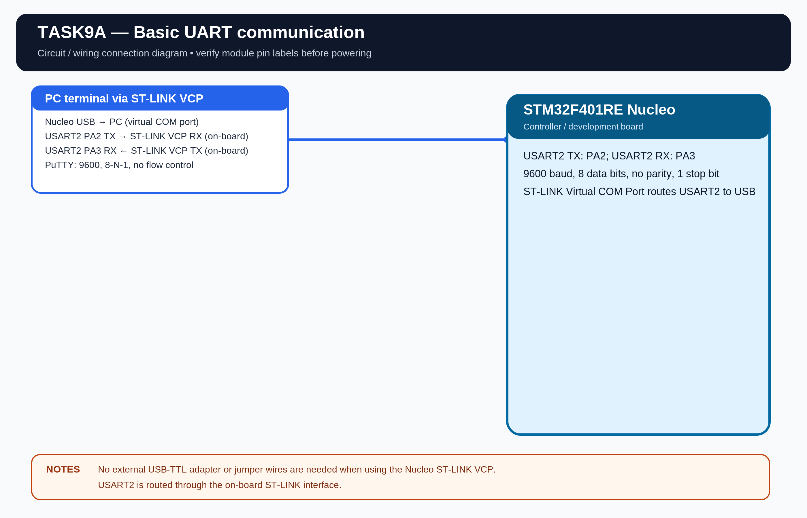

# EXPERIMENT DETAILS

**EXP:** CONTINUOUS LAB EVALUATION 9

**DATE:** 28/09/2026

**NAME OF EXP:** Basic UART Communication

**HARDWARE:** STM32F401RE Nucleo + PC terminal

## Aim

Establish UART communication between the STM32 and a PC terminal. Transmit a character repeatedly and echo every character received from the PC.

## UART Configuration

- Peripheral: USART2.
- TX: PA2.
- RX: PA3.
- Baud rate: 9600 (assumed because the task sheet does not specify one).
- Frame: 8 data bits, no parity, 1 stop bit.
- Terminal: ST-LINK Virtual COM Port.

## Working

The firmware transmits the character \`A\` once every second. Every character received from the terminal is sent back to the PC.

## Algorithm

1. Initialize HAL and USART2.
2. Transmit a ready message.
3. Receive a character from the PC.
4. Echo the received character.
5. Transmit \`A\` once every second using the HAL tick.
6. Repeat.

## Code

The program uses \`HAL_UART_Init()\`, \`HAL_UART_Transmit()\`, \`HAL_UART_Receive()\` and \`HAL_GetTick()\`.

## PuTTY Settings

- Serial line: ST-LINK Virtual COM Port.
- Speed: 9600.
- Data bits: 8.
- Stop bits: 1.
- Parity: None.
- Flow control: None.

## CR/LF Tests

Try these strings and record the observed terminal behavior:

- \`HELLO\r\n\`
- \`HELLO\r\`
- \`HELLO\n\`
- \`HELLO\r\nWORLD\r\n\`

CR moves the cursor to the start of the line. LF moves the cursor down to the next line.

## Circuit Diagram

## Build

Open \`MDK-ARM/TASK9A.uvprojx\` in Keil MDK-ARM and build the target. The HEX output is created in \`MDK-ARM/Objects/\`.

## Testing

The standalone Task 9A project is separated from the command-control application. Physical testing of this standalone project is pending.
