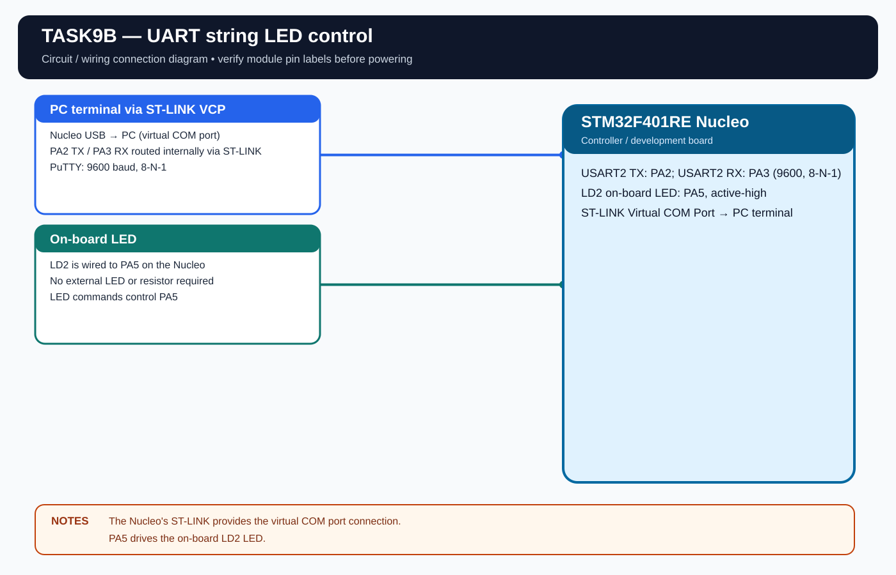

# EXPERIMENT DETAILS

**EXP:** CONTINUOUS LAB EVALUATION 9

**DATE:** 28/09/2026

**NAME OF EXP:** String-Based UART LED Control

**HARDWARE:** STM32F401RE Nucleo + PC terminal

## Aim

Receive string commands from a PC terminal and control the onboard LED using UART.

## UART and GPIO Configuration

- USART2 TX: PA2.
- USART2 RX: PA3.
- Baud rate: 9600, 8-N-1.
- LD2 LED: PA5, output, active high.
- Terminal: ST-LINK Virtual COM Port.

## Working

The firmware accepts these commands:

| Command | Action |
|---|---|
| \`LED ON\` | Turns the LED ON |
| \`LED OFF\` | Turns the LED OFF |
| \`LED TOGGLE\` | Toggles the LED |

Each received character is echoed. The command is processed when a carriage return or line feed is received. Uppercase and lowercase commands are accepted.

## Algorithm

1. Initialize HAL, USART2 and the LED GPIO.
2. Receive and echo terminal characters.
3. Store the characters in a command buffer.
4. Detect CR or LF as the command terminator.
5. Compare the command with the supported strings.
6. Control the LED and send a status message.
7. Clear the buffer and continue.

## Code

The program uses \`HAL_UART_Init()\`, \`HAL_UART_Transmit()\`, \`HAL_UART_Receive()\`, \`HAL_GPIO_WritePin()\`, \`HAL_GPIO_TogglePin()\` and \`HAL_GetTick()\`.

## PuTTY Settings

- Serial line: ST-LINK Virtual COM Port.
- Speed: 9600.
- Data bits: 8.
- Stop bits: 1.
- Parity: None.
- Flow control: None.
- Local echo: Off.

## Circuit Diagram

## Build

Open \`MDK-ARM/TASK9B.uvprojx\` in Keil MDK-ARM and build the target. The HEX output is created in \`MDK-ARM/Objects/\`.

The existing CAT9 HEX is retained here as the earlier combined Task 9A/9B build. Rebuild from this standalone Task 9B project to regenerate its output.

## Testing

The standalone Task 9B project is separated from the basic UART-only Task 9A project. Physical testing of this standalone project is pending.
